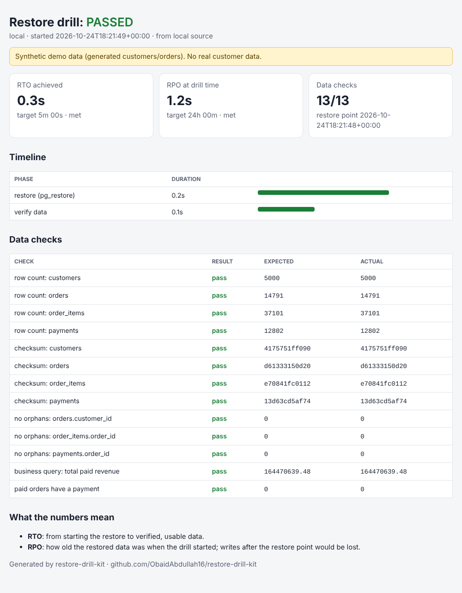

# restore-drill-kit

[](https://github.com/ObaidAbdullah16/restore-drill-kit/actions/workflows/ci.yml)

> **Synthetic data only.** Every drill here uses generated customers and orders (`restoredrill seed`).
> Reports carry a "synthetic demo data" banner.

**Backups are only real if they restore.** This kit restores a Postgres backup into an isolated sandbox,
proves the data is identical with 13 checks, measures **RTO** (time to recover) and **RPO** (data-loss
window), checks whether one identity could delete production *and* its backups, and writes a report.
It powers my **Backup & Restore Drill** service (S4).



## Two ways to run a drill

| | Local (free) | AWS RDS (on demand) |
|---|---|---|
| Source | Postgres container "prod" | RDS PostgreSQL 16 (db.t4g.micro) |
| Backup | `pg_dump` + manifest | automated backups + manual snapshot + manifest in S3 |
| Restore | `pg_restore` into a brand-new database on a "sandbox" server | new RDS instance from **snapshot** or **point-in-time** |
| Access | localhost | security group opened for **your IP only, only while verifying** |
| Cost | $0 | ~$0.03-0.04/hour while up (by Region); a drill adds a few cents |
| Command | `bash scripts/local-drill.sh` | `bash scripts/up.sh` -> `bash scripts/drill.sh` -> `bash scripts/down.sh` |

CI runs a **real local drill on every push** (two Postgres service containers, 5,000 synthetic customers)
and attaches the report to the run - see the Actions tab.

## What "verified" means

A manifest is captured from the source at backup time: row counts, an MD5 checksum of every table
(rows ordered by primary key, session time zone pinned to UTC), the newest timestamps, and a business
total (paid revenue). After restoring, the kit checks:

- row counts and checksums for `customers`, `orders`, `order_items`, `payments`
- no orphaned foreign keys
- business query (total paid revenue) matches
- every paid order has a payment

`tests/test_local_drill.py` proves the drill **fails** when the backup does not match the manifest.

## Backup isolation checks (`restoredrill isolation`)

| Check | Pass when |
|---|---|
| Automated backup retention | >= 7 days |
| Deletion protection | enabled |
| Public snapshots | no snapshot is shared with `all` (any AWS account could restore it) |
| Copy in another account | reported as *info*: a snapshot shared with a backup account is **not a copy** until that account copies it |
| Copy in another region | a copy of **this** database's data, captured in the last 7 days, exists (`--copy-region`) |
| Immutable vault | an AWS Backup vault has Vault Lock |
| Blast radius of the app identity | IAM simulation says the app/CI role **cannot** delete snapshots, backups or object versions (`--app-role-arn`) |

## Quick start

```bash
pip install -e ".[dev]"

# Local, with Docker
bash scripts/local-drill.sh            # -> reports/local/report.html

# AWS (needs aws-foundation applied, ~15 minutes for RDS to start)
bash scripts/up.sh                     # VPC + RDS + synthetic data + snapshot + manifest
bash scripts/drill.sh                  # snapshot restore -> verify -> delete sandbox -> report
MODE=pitr bash scripts/drill.sh        # point-in-time restore (RPO in minutes)
bash scripts/down.sh                   # delete sandboxes, kit snapshots and the whole stack (nothing is kept;
                                       # --all is accepted and does the same)
```

One-click from GitHub: **Actions > Control (start / stop) > Run workflow** with `up`, `drill`,
`drill-pitr`, `down` or `status`. A nightly **Auto-stop** workflow runs `down` at 00:00 IST in case you forget.

## Design decisions (interview talking points)

- **Prove, don't eyeball:** checksums turn "the restore looks fine" into evidence.
- **RPO is measured, not assumed:** snapshot mode shows the snapshot age; PITR mode restores to
  `LatestRestorableTime`, usually minutes.
- **Temporary, minimal access:** security groups have *no* rules; the tool adds `<your-ip>/32` only while it
  seeds or verifies, then revokes it (tested). Restored sandboxes get their **own** security group, so the
  "production" database is never opened during a drill (tested).
- **A failed restore is a result, not a crash:** a dump that won't restore or a sandbox that can't be reached
  produces a FAILED report with the error, and the sandbox is still deleted (tested).
- **Cleanup by tag:** sandboxes and kit snapshots are tagged `restore-drill`, so `down` never leaves billable leftovers.
- **Checkov runs in CI** with a documented skip list: each skip is a cost decision for a throwaway demo
  (flow logs, KMS, Multi-AZ...) that I would *not* skip for a client.

See [docs/service-playbook.md](docs/service-playbook.md) for how the service is delivered.

MIT licensed.
